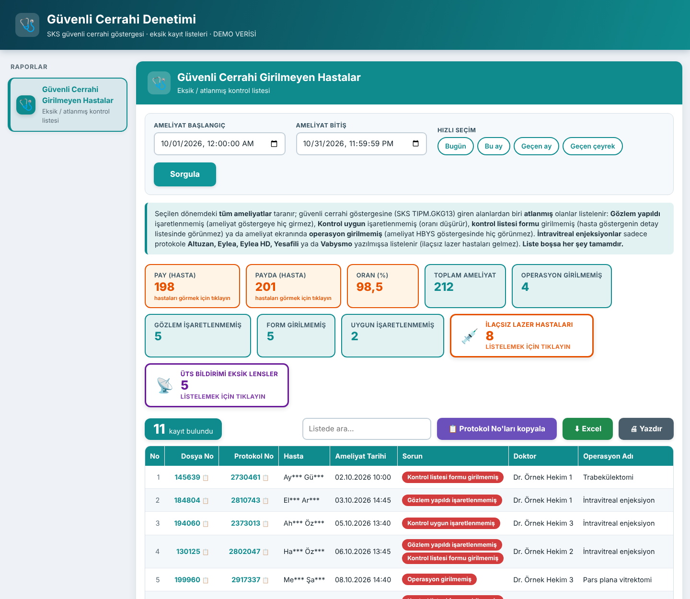

# 🩺 Surgical Safety Checklist Audit

**Find every surgery with a missing or incomplete safety checklist before the quality audit does.**

A lightweight web tool for hospitals using the Turkish Health Quality Standards (SKS). It scans **all** surgeries in a period, flags the ones that would break the *Safe Surgery* indicator (SKS code **TIPM.GKG13**), and reproduces the indicator's numerator, denominator and rate exactly as the hospital information system (HBYS) calculates it.

Built and used in a private eye & ENT hospital, then open-sourced with all patient and institutional data removed.



> 🇹🇷 Arayüz Türkçedir. Ekrandaki tüm hasta adları ve numaralar **demo verisidir**.

---

## The problem

The SKS safe surgery indicator only counts a surgery if several fields are filled in correctly in the HBYS. One unticked box silently drops a surgery from the indicator or lowers the rate. Usually it's discovered months later during the audit, when it's too late to fix.

## What it does

| Check | Why it matters |
|---|---|
| **"Observation done" not ticked** | The surgery never enters the indicator at all |
| **"Checklist compliant" not ticked** | Lowers the indicator rate |
| **Checklist form not entered** | The patient is missing from the indicator's detail list |
| **Operation not entered** | The surgery is invisible to the indicator |
| **Numerator / denominator / rate** | Same formula as the HBYS indicator card, so the numbers match |
| **Intravitreal injections without drug** | Laser-only patients are separated out so they don't create false alarms |
| **Missing ÜTS notifications** | Finds implanted lenses with no usage notification in ÜTS (the national medical device tracking system) |

Every list can be exported to **Excel** or printed, and file and protocol numbers are **one-click copy** for fast correction in the HBYS.

**If the list is empty, everything is in order.**

## Security & privacy

- **Read-only.** The app only runs `SELECT` queries. Use a dedicated read-only database user.
- **Access control.** An optional IP allowlist and HTTP Basic login protect patient data (KVKK / GDPR).
- **No data leaks.** Database errors are logged on the server only; the browser gets a generic message.
- **No caching.** Patient lists are sent with `Cache-Control: no-store` and anti-framing headers.
- **No secrets in the repo.** Credentials live in `config.ini`, which is git-ignored.

## Quick start

**Try it without a database (demo data):**
```bash
pip install -r requirements.txt
DEMO=1 python app.py            # Windows: set DEMO=1 && python app.py
```
Open `http://localhost:5051`.

**With your HBYS (Oracle):**
1. Copy `config.ini.ornek` to `config.ini` and fill in the database details.
2. On Windows: run `kurulum.bat` as administrator once, then `baslat.bat`.

## Tech stack

`Python` · `Flask` · `python-oracledb` · `openpyxl` · `Waitress` · Vanilla JS

The SQL targets the `HASTANE` schema of an Oracle-based HBYS. For a different HBYS, adapt the table and column names in `raporlar.py`.

## Project structure

```
app.py            Web server: routes, access control, Excel export
raporlar.py       Reports: SQL, columns, indicator calculations, demo data
demo.py           Fake data generator for demo mode
templates/        Single-page UI
```

## Related projects

- [lens-stock-expiry-tracker](https://github.com/bigwarstart/lens-stock-expiry-tracker): intraocular lens stock & expiry tracking
- [sks-medical-records-reports](https://github.com/bigwarstart/sks-medical-records-reports): SKS medical records & archive reports
- [his-protocol-autofill](https://github.com/bigwarstart/his-protocol-autofill): one-click protocol number entry into the HBYS
- [clinic-intranet](https://github.com/bigwarstart/clinic-intranet): secure hospital intranet

## Author

**Fatih Koçan**: IT Manager with 25+ years in hospital IT, Web3 developer & ambassador

[](https://www.linkedin.com/in/fatihkocan-3bbb49349/)
[](https://github.com/bigwarstart)
